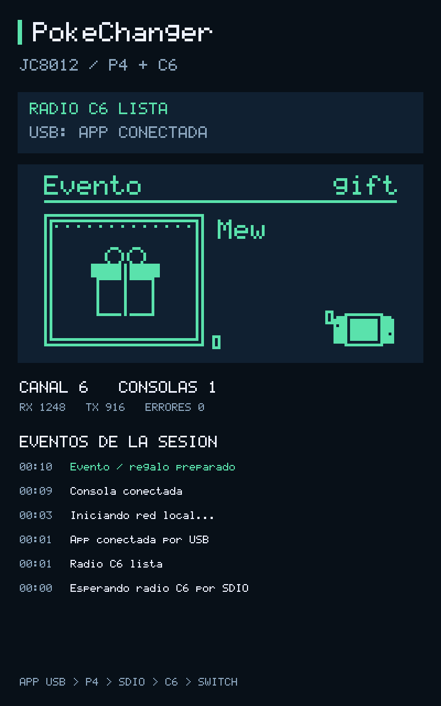

# PokeChanger — JC8012P4A1C_I_W_Y

Adaptación experimental de [Decryptu/pokeldn](https://github.com/Decryptu/pokeldn) para usar
la placa como comunicador USB con la Switch y mostrar los eventos en su pantalla de 10,1 pulgadas.
**Ambos firmwares compilan con ESP-IDF v6.1. Falta validación en una placa y una Switch reales.**
No hay un dispositivo conectado durante el desarrollo inicial. La compilación y las pruebas de
protocolo no demuestran todavía un intercambio o una entrega de regalos por radio.

## Funcionamiento

```text
App pokeldn en ordenador
       | USB-C / CH340C / UART0 (COBS + CRC32, protocolo original)
       v
ESP32-P4: puente USB, pantalla de eventos, escenas y sprites de la app
       | SDIO de 4 bits a 20 MHz, registros PKLD, protocolo interno v1
       v
ESP32-C6: firmware de radio pokeldn, claves CCMP y hooks Wi-Fi originales
       | LDN / Pia, 2,4 GHz
       v
Nintendo Switch
```

La app sigue ejecutando la autenticación LDN, la lógica de cada juego y la gestión de los datos.
El P4 no sustituye al ordenador. La radio necesita el firmware específico del C6: el firmware
ESP-Hosted de fábrica no contiene los hooks privados WPA que usa pokeldn. Instalar solamente el
firmware P4 no habilita la comunicación con la consola. No se utiliza esp_wifi remoto en el P4.

El monitor pasivo muestra conexión USB, disponibilidad del C6, canal, consolas conectadas,
tramas Ethernet recibidas y enviadas, errores de comandos y los ocho eventos más recientes.
La zona central reutiliza las escenas originales de intercambio, Pokémon y Mystery Gift de la app,
ampliadas a 640 × 320. Los eventos no guardan las claves ni los paquetes de juego.
TX cuenta comandos de envío remitidos, no confirmaciones por radio. Las horas son minutos/segundos
desde el arranque, no hora de calendario.

El protocolo USB mantiene sus créditos y cambio de baudrate en el P4; DISPLAY se ejecuta localmente.
Los demás comandos llegan al C6. Cada registro SDIO contiene versión, tipo, longitud LE y payload.
El C6 mantiene **un único envío SDIO pendiente** hasta que el P4 lo ha leído completo; esto conserva
la frontera de registros sobre ESSL, cuya API informa de los bytes disponibles. No debe aumentarse
el número de envíos simultáneos sin añadir un reensamblador de registros en el P4.
El C6 conserva el watchdog de la app: ALIVE cada segundo y cierre de red tras cinco segundos de silencio.



*Ejemplo simulado con el renderer del firmware; no es una fotografía de la placa.*

## Hardware verificado contra las fuentes publicadas

Fuentes consultadas: [esquemas y demo de la placa](https://github.com/wegi1/ESP32P4-JC8012P4A1C-I_W_Y/tree/0c1bbcfdbaa87bbc4686cde98b7deb556711064d),
[SDIO de ESP-IDF](https://github.com/espressif/esp-idf/tree/v6.1/examples/peripherals/sdio)
y [controlador JD9365 de Espressif](https://components.espressif.com/components/espressif/esp_lcd_jd9365/versions/2.0.2).
La correspondencia se ha comprobado en los esquemas; no se han medido señales en hardware.

| Señal | GPIO P4 | GPIO C6 |
|---|---:|---:|
| SDIO CLK | 18 | 19 |
| SDIO CMD | 19 | 18 |
| SDIO D0 | 14 | 20 |
| SDIO D1 | 15 | 21 |
| SDIO D2 | 16 | 22 |
| SDIO D3 | 17 | 23 |
| C6 EN / reset | 54 | EN |
| UART0 hacia CH340C | TX 37, RX 38 | — |
| LCD reset | 27 | — |
| Retroiluminación PWM | 23 | — |
| BOOT | 35 | — |
| Touch GSL3680 | SDA 7, SCL 8, INT 21, RST 22 | — |

La pantalla es JD9365, MIPI-DSI de dos carriles, RGB565, 800 × 1280 en orientación vertical.
El driver usa LDO3 a 2500 mV y los registros y timings de la demo publicada: reloj de píxel
63 MHz, H 20/20/40 y V 8/4/20 (back porch / pulse / front porch).
`main/panel_registers.h` transcribe los valores de inicialización de esa demo.
El lector táctil GSL3680 queda pendiente; el monitor actual no requiere interacción táctil.
BOOT despierta la escena y la retroiluminación baja tras un minuto sin actividad y se apaga tras diez.
El primer renderer usa un framebuffer de scanout y otro canvas en PSRAM; puede haber tearing,
pendiente de medir en la pantalla real. No se ha añadido una dependencia de LVGL.

## Compilar

Se requiere **ESP-IDF v6.1**; los hooks de radio del upstream dependen de su ABI privada.
El SDK v5.2 de la demo del fabricante no es compatible con esos hooks.

```sh
. /ruta/a/esp-idf/export.sh
python scripts/build_jc8012.py
```

Genera `dist/jc8012p4/pokechanger-p4.bin`, `pokechanger-c6.bin`, `manifest.json` y `SHA256SUMS`.
Son imágenes combinadas con bootloader y tabla de particiones, destinadas a flashearse a **0x0**
en el chip correspondiente. El script no busca puertos ni escribe en una placa.
Los proyectos separados son `firmware/jc8012p4` (P4) y `firmware/jc8012p4/radio` (C6).
Se fijan las dependencias JD9365 2.0.2 y ESSL 1.1.0; CMake declara para ESSL las dependencias de
drivers y el include de heap que ya no recibe de forma transitiva en IDF 6.1.

**Revisión del P4:** la configuración por defecto sigue la demo de la placa y admite silicio
v0.1–v1.x (`CONFIG_ESP32P4_SELECTS_REV_LESS_V3=y`, revisión mínima 0.1). ESP-IDF 6.1 separa
esas revisiones de v3.x. Consultar primero `esptool --chip esp32p4 --port PUERTO chip-id`.
Para una placa con P4 v3.x hay que cambiar la revisión en `idf.py -C firmware/jc8012p4 menuconfig`
y recompilar; la imagen por defecto no sirve para ambas familias. No se ha confirmado la revisión
de la placa del usuario. Flash P4: 16 MB; PSRAM a 200 MHz como en la demo publicada.

Previsualización sin placa ni ESP-IDF (compilador C local; Pillow opcional para PNG):

```sh
python scripts/build_jc8012.py --preview-only
```

Renderiza un ejemplo de regalo con el mismo `dashboard.c` y `scene.c` del firmware en
`dist/jc8012p4/preview.ppm`. Si está instalado Pillow, crea también `preview.png`.
Es una simulación del contenido de pantalla, no una captura de la placa.

## Primera instalación

1. Comprobar la revisión del P4, la placa y el pinout de CN5 contra los esquemas.
2. Cargar el C6 por su cabecera **CN5** usando un adaptador UART de lógica **3,3 V**.
   El CH340C del USB-C programa el P4; no programa automáticamente el C6.
3. Cargar el P4 por el USB-C de programación.
4. Reiniciar toda la placa. El P4 reinicia también el C6 por GPIO54 e inicia SDIO.
5. En la app, seleccionar el puerto CH340 de la placa y utilizar las herramientas de juegos habituales.
   Los datos y claves que pide la app se configuran como en el upstream.

CN5 según el esquema `5_ESP32-C6.png`: 1 = 3V3, 2 = GND, 3 = C6 TXD,
4 = C6 RXD, 5 = C6 IO9 (BOOT), 6 = C6 EN. Cruzar TX del adaptador con RX del C6 y RX con TX,
y compartir GND. Mantener IO9 a GND durante el reset del C6 para entrar en el cargador ROM;
soltar IO9 para el arranque normal. No conectar el pin de 5 V de un adaptador a CN5.
Al programar el C6, el P4 no debe reiniciarlo durante la transferencia: mantener el P4 en su ROM
loader (BOOT+RESET del P4) o usar el procedimiento de aislamiento del fabricante.
La alimentación se mantiene por USB; no se presupone alimentación adicional desde el adaptador.

Con ESP-IDF cargado y el chip correspondiente en su bootloader:

```sh
idf.py -C firmware/jc8012p4/radio -p PUERTO_UART_C6 flash
idf.py -C firmware/jc8012p4 -p PUERTO_USB_P4 flash
```

Para las imágenes combinadas, una vez comprobado el chip y su revisión:

```sh
esptool --chip esp32c6 --port PUERTO_UART_C6 write-flash 0x0 dist/jc8012p4/pokechanger-c6.bin
esptool --chip esp32p4 --port PUERTO_USB_P4 write-flash 0x0 dist/jc8012p4/pokechanger-p4.bin
```

La app reconoce la identidad ESP32-P4, conserva las MAC del C6 para LDN y no ofrece actualizaciones
con el firmware genérico del C6. La pantalla Board de la app no instala aún este par de imágenes;
el flasheador de la app indica el procedimiento específico al detectar un P4.
El texto INFO usa `version=1.6.3` como versión de capacidades compatible con el upstream y
`board=JC8012P4A1C_I_W_Y radio=esp32c6` como identificación de esta adaptación experimental.

## Validación

Pruebas de registros SDIO (tamaños 0–1600, truncado, versión incompatible, overflow), estado del
monitor, errores, desconexión, watchdog con rollover, historial acotado, límites del framebuffer y selección de firmware:

```sh
python -m pytest tests/test_jc8012p4.py tests/test_esp32_screen.py tests/test_board_flash.py tests/test_esp32.py -q
```

Validación local del port inicial: ambos firmwares compilados y combinados; 117 pruebas de la
selección anterior pasaron. Las pruebas nativas se ejecutan con AddressSanitizer y UBSan.

Pendiente en hardware: enumeración CH340, HELLO/BAUD y BENCH sin pérdidas, estabilidad del bus
SDIO bajo carga, encendido y colores del panel, red LDN y conexión de una consola, un intercambio y
una entrega real de Mystery Gift en un juego compatible. Comprobar también desconexión USB,
reinicio conjunto P4/C6 y el cierre de red del watchdog. El touch queda fuera de esta primera versión.

La licencia AGPL-3.0 y los créditos del upstream se conservan. La documentación original continúa
aplicándose a los juegos y a la app.
